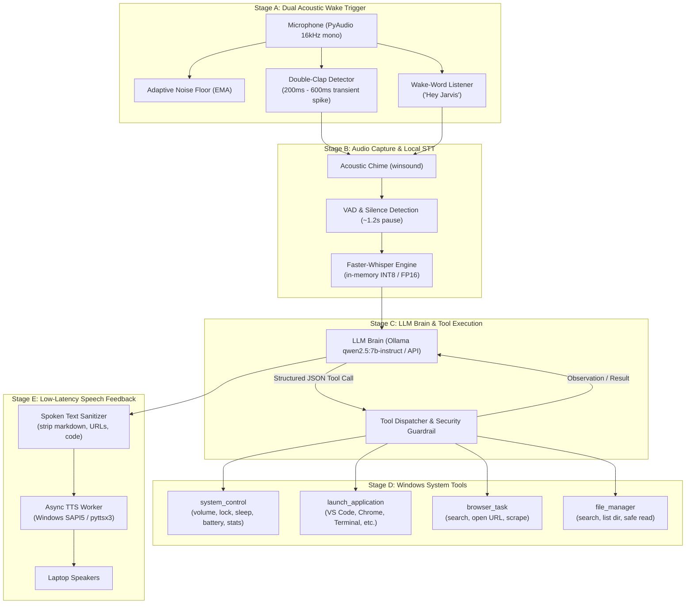

# J.A.R.V.I.S. — Production Local AI Assistant for Windows

An autonomous, local-first, low-latency AI assistant engineered specifically for Windows laptops. Features real-time acoustic **Double-Clap** and **Hotword** activation, local **Faster-Whisper** speech-to-text, structured **JSON Tool Calling** (Ollama / OpenAI / Gemini), native **Windows System Controls**, and zero-latency **SAPI5 TTS**.

---

## 1. System Architecture



---

## 2. Directory Structure

```text
jarvis_assistant/
│
├── config.py             # Acoustic thresholds, timing windows, model names, paths
├── audio_listener.py     # PyAudio stream with Double-Clap & Wake-Word detector
├── stt_engine.py         # Faster-Whisper wrapper with winsound chimes and VAD
├── tools.py              # Windows system control, app launcher, browser, file manager
├── tts_engine.py         # Non-blocking Windows SAPI5 TTS with markdown sanitizer
├── agent_core.py         # Main event-driven state machine coordinating all loops
├── diagnostics.py        # Subsystem verification suite
├── requirements.txt      # Pinned dependencies
└── README.md             # Architecture and deployment guide
```

---

## 3. Installation Guide (Windows)

### Step 1: Install Python Dependencies
Open PowerShell or Windows Terminal:
```powershell
pip install -r requirements.txt
```

> **Note on PyAudio on Windows:**
> If `pip install pyaudio` fails due to missing PortAudio C headers, install the pre-compiled wheel:
> ```powershell
> pip install pipwin
> pipwin install pyaudio
> ```
> Or download the appropriate wheel for your Python version from [Gohlke's Unofficial Windows Binaries](https://www.lfd.uci.edu/~gohlke/pythonlibs/#pyaudio).

### Step 2: Install and Run Ollama (Local LLM)
1. Download Ollama for Windows from [ollama.com](https://ollama.com).
2. Open PowerShell and run the recommended model:
   ```powershell
   ollama run qwen2.5:7b-instruct
   ```
   *(Alternative: `ollama run llama3.1:8b`)*
3. Ollama will run locally at `http://localhost:11434` with native tool-calling capabilities.

---

## 4. Configuration Tuning (`config.py`)

All operational parameters are centralized in `config.py`:

| Parameter | Default | Description |
|---|---|---|
| `clap.min_clap_rms` | `2200.0` | Minimum RMS amplitude for candidate clap |
| `clap.spike_multiplier` | `4.2` | RMS must exceed `noise_floor * spike_multiplier` |
| `clap.min_clap_interval_sec` | `0.20s` (200ms) | Prevents reverberation echo triggers |
| `clap.max_clap_interval_sec` | `0.60s` (600ms) | Maximum allowable interval for double-clap |
| `stt.silence_timeout_sec` | `1.2s` | Speech finishes after 1.2s silence pause |
| `stt.model_size` | `"base.en"` | Faster-Whisper model (`base.en` or `small.en`) |
| `llm.model` | `"qwen2.5:7b-instruct"` | Ollama model identifier |
| `tts.rate` | `195` | Words per minute for speech output |

---

## 5. Verification & Diagnostics

Run the integrated diagnostics suite to verify your microphone, speakers, TTS voice, faster-whisper model, and Windows system tools:

```powershell
python diagnostics.py
```

---

## 6. Starting Jarvis

Run the main event loop:

```powershell
python agent_core.py
```

### Triggering Jarvis:
1. **Double-Clap**: Clap twice crisply within 200ms to 600ms.
2. **Hotword**: Say *"Hey Jarvis"* or *"Jarvis"*.
3. **Chime**: A subtle high-tech chime sounds, indicating Jarvis is listening.
4. **Speak**: Speak your request naturally (e.g., *"What is my battery level?"*, *"Increase the volume"*, *"Open Chrome and search for quantum computing"*).
5. **Auto-Stop**: Stop speaking for ~1.2s. Jarvis will process your request, execute the tool, and speak back.
